# DER Foodapp — esquema PostgreSQL real

Versión editable para diagrams.net: [`der-foodapp.drawio`](./der-foodapp.drawio).
Abrir el `.drawio` en [app.diagrams.net](https://app.diagrams.net) y exportar con `File → Export as → PNG/SVG`.

```mermaid
erDiagram
    banners {
        serial id_banner PK "NOT NULL"
        varchar titulo "255; NOT NULL"
        text descripcion "NULL"
        varchar imagen "500; NOT NULL"
        boolean activo "NOT NULL; default true"
        integer orden "NOT NULL; default 0"
        timestamptz created_at "NOT NULL"
        timestamptz updated_at "NOT NULL"
        timestamptz deleted_at "NULL"
    }
    categoria_producto {
        serial id_categoria_producto PK "NOT NULL"
        integer id_producto FK, UK "NOT NULL; FK -> productos.id_producto; unique compuesto"
        integer id_categoria FK, UK "NOT NULL; FK -> categorias.id_categoria; unique compuesto"
    }
    categorias {
        serial id_categoria PK "NOT NULL"
        varchar nombre UK "255; NOT NULL; unique"
        timestamptz deleted_at "NULL"
    }
    clientes {
        serial id_cliente PK "NOT NULL"
        varchar nombre "255; NOT NULL"
        varchar apellido "255; NOT NULL"
        varchar tipo_doc "255; NULL"
        varchar dni "255; NULL"
        varchar email UK "255; NOT NULL; unique"
        varchar password "255; NOT NULL"
        timestamptz created_at "NOT NULL"
        timestamptz updated_at "NOT NULL"
    }
    detalle_pedido_opcionales {
        serial id_detalle_opcional PK "NOT NULL"
        integer id_detalle FK "NOT NULL; FK -> detalle_pedidos.id_detalle"
        integer id_opcional FK "NOT NULL; FK -> opcionales.id_opcional"
        numeric precio "NOT NULL; default 0"
    }
    detalle_pedidos {
        serial id_detalle PK "NOT NULL"
        integer id_pedido FK "NOT NULL; FK -> pedidos.id_pedido"
        integer id_producto FK "NOT NULL; FK -> productos.id_producto"
        integer cantidad "NOT NULL"
        numeric precio "NOT NULL"
        text observaciones "NULL"
        integer id_promocion FK "NULL; FK -> promociones.id_promocion"
        boolean preparado "NOT NULL; default false"
    }
    direcciones {
        serial id_direccion PK "NOT NULL"
        varchar calle "255; NOT NULL"
        varchar altura "255; NOT NULL"
        varchar piso "255; NULL"
        varchar departamento "255; NULL"
        varchar ciudad "255; NOT NULL"
        varchar provincia "255; NOT NULL"
        numeric latitud "NULL"
        numeric longitud "NULL"
        integer id_cliente FK "NOT NULL; FK -> clientes.id_cliente"
        timestamptz created_at "NOT NULL"
        timestamptz updated_at "NOT NULL"
        varchar codigo_postal "255; NULL"
        timestamptz deleted_at "NULL"
    }
    empleados {
        serial id_empleado PK "NOT NULL"
        varchar nombre "255; NOT NULL"
        varchar apellido "255; NOT NULL"
        varchar rol "255; NOT NULL; default 'ADMIN'"
        varchar email UK "255; NULL; unique"
        varchar password "255; NOT NULL"
        integer id_sucursal FK "NULL; FK -> sucursales.id_sucursal"
        timestamptz created_at "NOT NULL"
        timestamptz updated_at "NOT NULL"
        timestamptz deleted_at "NULL"
    }
    historial_pedidos {
        serial id_historial PK "NOT NULL"
        integer id_pedido FK "NOT NULL; FK -> pedidos.id_pedido"
        varchar estado "255; NOT NULL"
        timestamptz fecha_hora "NOT NULL"
    }
    materia_prima_sucursal {
        integer id_materia_prima PK, FK "NOT NULL; FK -> materias_primas.id_materia_prima"
        integer id_sucursal PK, FK "NOT NULL; FK -> sucursales.id_sucursal"
        integer stock "NOT NULL; default 0"
    }
    materias_primas {
        serial id_materia_prima PK "NOT NULL"
        varchar nombre UK "255; NOT NULL; unique"
        varchar estado "255; NOT NULL; default 'disponible'"
        timestamptz created_at "NOT NULL"
        timestamptz updated_at "NOT NULL"
        timestamptz deleted_at "NULL"
        integer stock_minimo "NOT NULL; default 0"
    }
    opcionales {
        serial id_opcional PK "NOT NULL"
        varchar nombre "255; NOT NULL"
        text descripcion "NULL"
        numeric precio "NOT NULL; default 0"
        varchar estado "255; NOT NULL; default 'disponible'"
        integer id_producto FK "NOT NULL; FK -> productos.id_producto"
        timestamptz created_at "NOT NULL"
        timestamptz updated_at "NOT NULL"
        timestamptz deleted_at "NULL"
    }
    pedidos {
        serial id_pedido PK "NOT NULL"
        timestamptz fecha_hora "NOT NULL"
        numeric importe "NOT NULL; default 0"
        varchar estado "255; NOT NULL; default 'Pendiente'"
        integer id_cliente FK "NOT NULL; FK -> clientes.id_cliente"
        integer id_sucursal FK "NULL; FK -> sucursales.id_sucursal"
        integer id_direccion FK "NOT NULL; FK -> direcciones.id_direccion"
        timestamptz deleted_at "NULL"
    }
    producto_materia_prima {
        integer id_producto PK, FK "NOT NULL; FK -> productos.id_producto"
        integer id_materia_prima PK, FK "NOT NULL; FK -> materias_primas.id_materia_prima"
        integer cantidad "NOT NULL; default 1"
    }
    producto_pedido {
        serial id_producto_pedido PK "NOT NULL"
        integer id_producto FK, UK "NOT NULL; FK -> productos.id_producto; unique compuesto"
        integer id_pedido FK, UK "NOT NULL; FK -> pedidos.id_pedido; unique compuesto"
    }
    productos {
        serial id_producto PK "NOT NULL"
        varchar nombre "255; NOT NULL"
        text descripcion "NULL"
        numeric precio "NOT NULL"
        varchar imagen "255; NULL"
        varchar estado "255; NOT NULL; default 'disponible'"
        timestamptz created_at "NOT NULL"
        timestamptz updated_at "NOT NULL"
        timestamptz deleted_at "NULL"
    }
    promocion_producto {
        serial id_promocion_producto PK "NOT NULL"
        integer id_promocion FK, UK "NOT NULL; FK -> promociones.id_promocion; unique compuesto"
        integer id_producto FK, UK "NOT NULL; FK -> productos.id_producto; unique compuesto"
        integer cantidad "NOT NULL; default 1"
    }
    promociones {
        serial id_promocion PK "NOT NULL"
        varchar nombre "255; NOT NULL"
        text descripcion "NULL"
        varchar tipo "255; NOT NULL"
        numeric valor "NOT NULL; default 0"
        date fecha_inicio "NOT NULL"
        date fecha_fin "NOT NULL"
        boolean activa "NOT NULL; default true"
        timestamptz created_at "NOT NULL"
        timestamptz updated_at "NOT NULL"
        varchar imagen "255; NULL"
        timestamptz deleted_at "NULL"
    }
    sucursal_horarios {
        serial id_horario PK "NOT NULL"
        integer id_sucursal FK "NOT NULL; FK -> sucursales.id_sucursal"
        smallint dia_semana "NOT NULL"
        time hora_apertura "NOT NULL"
        time hora_cierre "NOT NULL"
    }
    sucursales {
        serial id_sucursal PK "NOT NULL"
        varchar nombre "255; NOT NULL"
        varchar estado "255; NOT NULL; default 'activa'"
        varchar telefono "255; NULL"
        varchar calle "255; NOT NULL"
        varchar altura "255; NOT NULL"
        varchar ciudad "255; NOT NULL"
        varchar provincia "255; NOT NULL"
        numeric latitud "NULL"
        numeric longitud "NULL"
        timestamptz created_at "NOT NULL"
        timestamptz updated_at "NOT NULL"
        varchar codigo_postal "255; NULL"
        timestamptz deleted_at "NULL"
        numeric radio_km "NOT NULL; default 2"
    }
    categorias ||--|{ categoria_producto : "id_categoria"
    productos ||--|{ categoria_producto : "id_producto"
    detalle_pedidos ||--|{ detalle_pedido_opcionales : "id_detalle"
    opcionales ||--|{ detalle_pedido_opcionales : "id_opcional"
    pedidos ||--|{ detalle_pedidos : "id_pedido"
    productos ||--|{ detalle_pedidos : "id_producto"
    promociones ||--o{ detalle_pedidos : "id_promocion"
    clientes ||--|{ direcciones : "id_cliente"
    sucursales ||--o{ empleados : "id_sucursal"
    pedidos ||--|{ historial_pedidos : "id_pedido"
    materias_primas ||--|{ materia_prima_sucursal : "id_materia_prima"
    sucursales ||--|{ materia_prima_sucursal : "id_sucursal"
    productos ||--|{ opcionales : "id_producto"
    clientes ||--|{ pedidos : "id_cliente"
    direcciones ||--|{ pedidos : "id_direccion"
    sucursales ||--o{ pedidos : "id_sucursal"
    materias_primas ||--|{ producto_materia_prima : "id_materia_prima"
    productos ||--|{ producto_materia_prima : "id_producto"
    pedidos ||--|{ producto_pedido : "id_pedido"
    productos ||--|{ producto_pedido : "id_producto"
    productos ||--|{ promocion_producto : "id_producto"
    promociones ||--|{ promocion_producto : "id_promocion"
    sucursales ||--|{ sucursal_horarios : "id_sucursal"
```

> La versión Mermaid usa tipos simplificados (por ejemplo `varchar` en lugar de `varchar(255)`); el archivo `.drawio` contiene el detalle completo de tipos y defaults.
